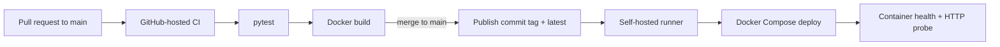

# DevOps Practical · Delivery Lab


A portfolio-friendly DevOps lab built around a small Flask service. The app stays focused so the delivery work is easy to see: review a change, run checks, build and publish a container image, then deploy it with Docker Compose.

## What this lab demonstrates

- A responsive service dashboard with environment and release details.
- A JSON health probe for the container and deployment workflow.
- A non-root Docker image served by Gunicorn.
- Pull request checks on GitHub-hosted runners.
- Commit-tagged container publishing to Docker Hub after changes reach `main`.
- Deployment from `main` on a self-hosted runner, followed by a container health check and HTTP probe.

## Delivery flow



The publish and deploy steps run only for a push to `main`. Pull requests run the tests and build the image without using Docker Hub credentials or the self-hosted runner.

## Run locally

Requirements: Docker Engine with the Compose plugin.

```bash
APP_ENV=local docker compose up --build -d
```

Open [http://localhost:5000](http://localhost:5000), then try:

- `GET /` — the service dashboard.
- `GET /health` — container health response.
- `GET /api/status` — environment and release details as JSON.

Useful commands:

```bash
docker compose ps
docker compose logs -f app
docker compose down
```

Set a different host port with `APP_PORT=5080 APP_ENV=local docker compose up --build -d`.

## Run tests without Docker

```bash
python -m venv .venv
source .venv/bin/activate
python -m pip install -r app/requirements.txt
python -m pip install pytest
PYTHONPATH=. python -m pytest
```

## CI/CD setup

The workflow in [`.github/workflows/ci.yml`](.github/workflows/ci.yml) expects:

1. GitHub Actions repository secrets `DOCKER_USERNAME` and `DOCKER_PASSWORD`. Use a Docker Hub access token for the password.
2. A self-hosted GitHub Actions runner with the `self-hosted` label, Docker Engine, and the Docker Compose plugin.
3. Port `5000` available on the deployment host.

Pull request jobs run on GitHub-hosted runners. The self-hosted runner is used only after CI passes on a push to `main`. Keep that runner restricted to this trusted repository.

## A short interview introduction

> I built this lab to practice taking a change from pull request through automated tests and a container build, then publishing a commit-tagged image and deploying it with Docker Compose. The service includes a health endpoint so the deployment can verify the running container.

## Next steps

- Add a staging environment before production deployment.
- Add an explicit rollback workflow that deploys a selected commit tag.
- Add deployment notifications and basic runtime metrics.
