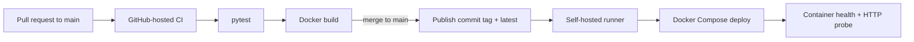

# DevOps Practical · Delivery Lab

<p>
  
  
  
</p>

[Pull request runs](https://github.com/arturasryan919-spec/DevopsPractical/actions/workflows/ci.yml?query=event%3Apull_request) · [Main CI runs](https://github.com/arturasryan919-spec/DevopsPractical/actions/workflows/ci.yml?query=branch%3Amain+event%3Apush) · [Deployment runs](https://github.com/arturasryan919-spec/DevopsPractical/actions/workflows/deploy.yml?query=event%3Aworkflow_run)


A portfolio-friendly DevOps lab built around a small Flask service. The app stays focused so the delivery work is easy to see: review a change, run checks, build and publish a container image, then deploy it with Docker Compose.

## What this lab demonstrates

- A responsive service dashboard with environment and release details.
- A JSON health probe for the container and deployment workflow.
- A non-root Docker image served by Gunicorn.
- Pull request checks on GitHub-hosted runners.
- Commit-tagged container publishing to Docker Hub after changes reach `main`.
- Deployment from `main` on a self-hosted runner, followed by a container health check and HTTP probe.

## Delivery flow



Pull requests run tests and build the image on GitHub-hosted runners. A push to `main` runs the same checks, publishes the image, and then starts the separate deployment workflow. The deployment badge tracks the WSL runner independently, so an offline runner cannot make the CI badge look failed.

## Run locally

Requirements: Docker Engine with the Compose plugin.

```bash
APP_ENV=local docker compose up --build -d
```

Open [http://localhost:5000](http://localhost:5000), then try:

- `GET /` — the service dashboard.
- `GET /health` — container health response.
- `GET /api/status` — environment and release details as JSON.

Useful commands:

```bash
docker compose ps
docker compose logs -f app
docker compose down
```

Set a different host port with `APP_PORT=5080 APP_ENV=local docker compose up --build -d`.

## Run tests without Docker

```bash
python -m venv .venv
source .venv/bin/activate
python -m pip install -r app/requirements.txt
python -m pip install pytest
PYTHONPATH=. python -m pytest
```

## CI/CD setup

The workflows in [`.github/workflows/ci.yml`](.github/workflows/ci.yml) and [`.github/workflows/deploy.yml`](.github/workflows/deploy.yml) expect:

1. GitHub Actions repository secrets `DOCKER_USERNAME` and `DOCKER_PASSWORD` for publishing to Docker Hub. Use a Docker Hub access token for the password.
2. A self-hosted GitHub Actions runner with the `self-hosted` label, Docker Engine, and the Docker Compose plugin for deployment.
3. Port `5000` available on the deployment host.

Pull request checks and main-branch CI run on GitHub-hosted runners. The deployment workflow starts only after a successful push CI run on `main`. Keep the self-hosted runner restricted to this trusted repository.

### Start the self-hosted runner in WSL

The deployment job needs the WSL runner online. If WSL is shut down or the runner process is stopped, GitHub cannot assign the job; it will wait for an available runner.

1. Open the WSL distribution where the GitHub Actions runner was configured.
2. In its terminal, go to the runner's installation folder (the example below assumes `~/actions-runner`):
   ```bash
   cd ~/actions-runner
   ./run.sh
   ```
3. Keep that terminal open. Confirm it says **Listening for Jobs**, then check the repository's **Settings → Actions → Runners** page shows the runner as **Online** or **Idle**.

When the runner returns online, a job that is still queued should start automatically. If the deployment job has already failed, bring the runner online first, then re-run the failed job from the Actions page.

## A short interview introduction

> I built this lab to practice taking a change from pull request through automated tests and a container build, then publishing a commit-tagged image and deploying it with Docker Compose. The service includes a health endpoint so the deployment can verify the running container.

## Next steps

- Add a staging environment before production deployment.
- Add an explicit rollback workflow that deploys a selected commit tag.
- Add deployment notifications and basic runtime metrics.
